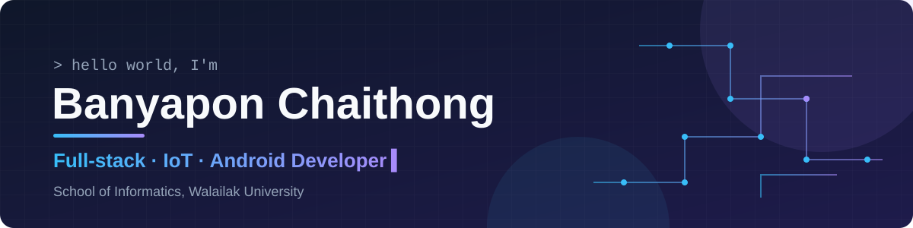
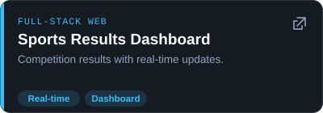
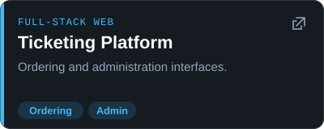
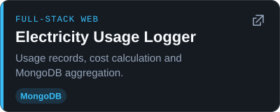
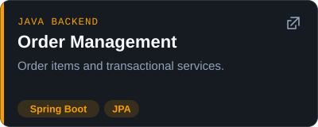
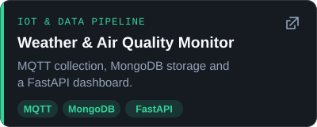
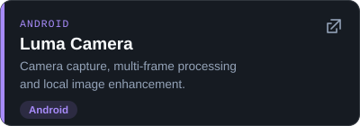
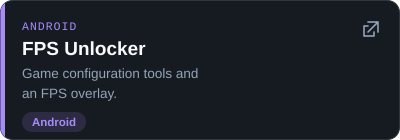
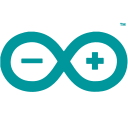

  <picture>
    <source media="(max-width: 700px)" srcset="assets/banner-mobile.svg" />
    
  </picture>

  
  
  

Academic email: <a href="mailto:banyapon.ch@mail.wu.ac.th">banyapon.ch@mail.wu.ac.th</a> &nbsp;·&nbsp; <a href="mailto:banyapon.ch@st.wu.ac.th">banyapon.ch@st.wu.ac.th</a>

## 👋 About Me

I am **Banyapon Chaithong**, an undergraduate student at the **School of Informatics, Walailak University**, majoring in **Intelligent Information Technology**.

My project portfolio focuses on **Frontend & Backend Development, REST APIs, IoT projects with ESP32/ESP8266, and Android applications**. I learn through practical projects and aim to build useful software by connecting clear interfaces, backend logic and data.

## 🚀 Featured Projects

  
  
  
  
  
  
  

## 🛠️ Tech Stack

<strong>Frontend</strong> 
  &nbsp; &nbsp; &nbsp; &nbsp;  
  HTML · CSS · JavaScript · TypeScript · React · Vite

<strong>Backend &amp; APIs</strong> 
  &nbsp; &nbsp; &nbsp; &nbsp; &nbsp;  
  Node.js · Express · Python · FastAPI · Java · Spring Boot · JPA

<strong>Databases</strong> 
  &nbsp;  
  MySQL · MongoDB

<strong>IoT &amp; Real-time</strong> 
   
  ESP32/ESP8266 · MQTT · Socket.IO

<strong>Android</strong> 
  &nbsp;  
  Kotlin · Java · CameraX · WorkManager

<strong>Dev Tools</strong> 
  &nbsp;  
  Git · Docker · GitHub Actions

## 📄 Portfolio &amp; Resume

  <a href="https://github.com/BunnyBubui/test">📂 Portfolio</a> &nbsp;•&nbsp;
  <a href="https://github.com/BunnyBubui/test/blob/main/portfolio/RESUME.en.md">📄 Resume (English)</a> &nbsp;•&nbsp;
  <a href="https://github.com/BunnyBubui/test/blob/main/portfolio/RESUME.th.md">📄 เรซูเม่ภาษาไทย</a>

